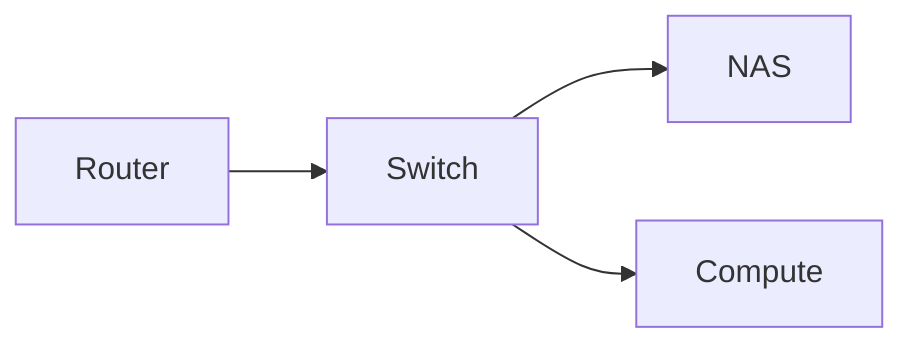

Exists so every markdown feature can be checked on one page. `build.list: never`
keeps it out of lists, feeds, the sitemap and the search index; it still renders
at `/articles/fixtures/`.

## Alerts

> [!NOTE]
> Ordinary aside.

> [!TIP] Custom title
> The title after the marker overrides the default label.

> [!IMPORTANT]
> Renders with the `circle-alert` icon.

> [!WARNING]
> Renders with the `triangle-alert` icon.

> [!CAUTION]
> Renders with the `octagon-alert` icon.

A plain blockquote still renders as a blockquote:

> Not an alert.

## Maths

Inline: \(e^{i\pi} + 1 = 0\).

Block:

$$
\int_{-\infty}^{\infty} e^{-x^2}\,dx = \sqrt{\pi}
$$

Both become MathML at build time — no client-side maths library ships.

## Table

| Component   | Role       | Watts |
| ----------- | ---------- | ----: |
| Gigabyte Brix | Compute  |    15 |
| Synology DS220+ | Storage |    18 |
| Raspberry Pi 4 | Edge    |     6 |

## Code

```go
package main

import "fmt"

func main() {
	fmt.Println("hello")
}
```

With highlighted lines:

```python {hl_lines=["2-3"]}
def total(items):
    subtotal = sum(i.price for i in items)
    return subtotal * 1.21
```

Characters that used to break the copy button — quotes, apostrophes, newlines
and a literal closing script tag:

```html
<p class="x" data-y='z'>it's fine</p>
<script>console.log("</script>")</script>
```

An unknown language falls back to a plain `<pre>`:

```notalanguage
;; no lexer for this
```

From a page resource with `{file="sample.go"}`:

```go {file="sample.go"}
```

## Mermaid



## Images

A regular image with a caption:


Full-bleed, via a block attribute:


{class="full-bleed"}

## Links

- [Internal page reference](/page/about)
- [External link](https://gohugo.io/)
- [Absolute link to this site](https://www.marku.me/articles/)
- [Anchor](#alerts)

## Footnote

Text with a footnote.[^1]

[^1]: The footnote body.
